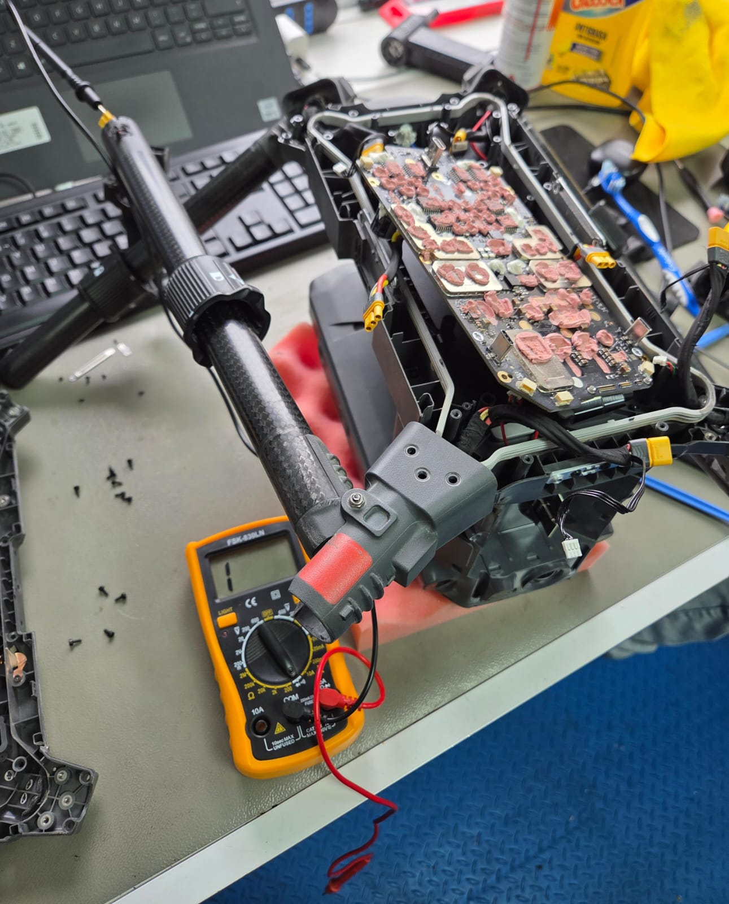
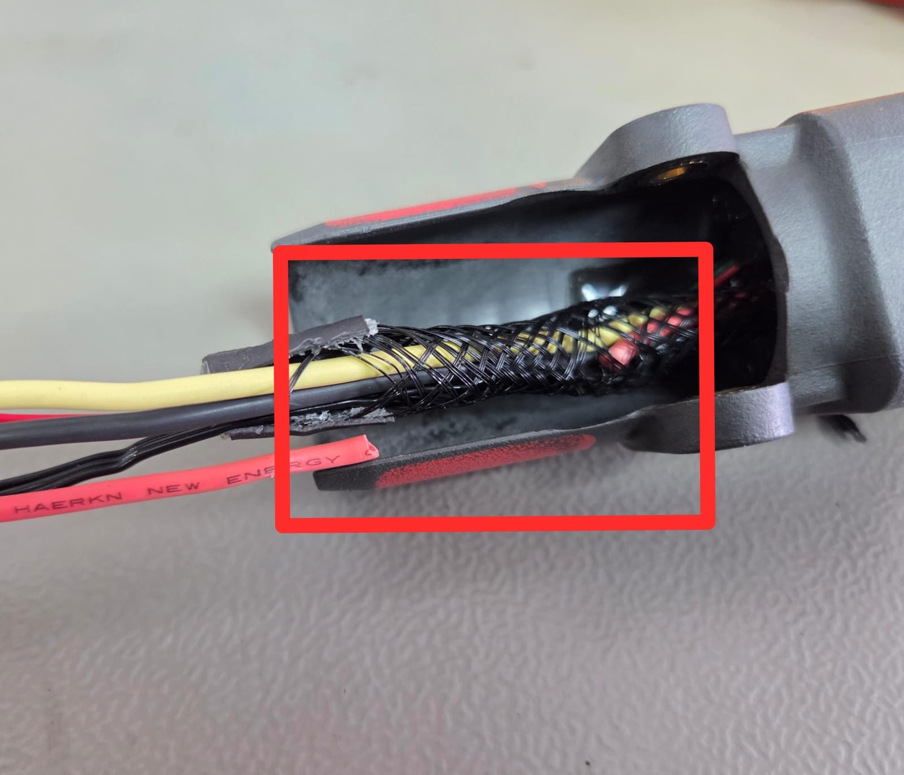

# Diagnóstico de fallas de ESC y hardware de propulsión — DJI Matrice 350 RTK Enterprise

- Fecha de diagnóstico: 08-10-2026
- Equipo: DJI Matrice 350 RTK
- Sistema afectado: ESC y hardware de propulsión
- Componente defectuoso: Cable de fase del motor de propulsión del brazo M2

---

## Contexto

El equipo presentaba errores intermitentes de ESC y hardware de propulsión después de operaciones de vuelo. En una intervención anterior se había reemplazado la ESC; sin embargo, la falla persistió después de nuevos usos en terreno.

### Síntoma reportado

- Aparición intermitente de errores de ESC y hardware de propulsión después del reinicio del equipo o al finalizar operaciones de vuelo.

Debido a la persistencia de la falla tras el reemplazo de la ESC, se realizó una inspección eléctrica de los cables de los motores de propulsión para verificar su continuidad.

---

## Procedimiento de diagnóstico

### Condiciones de medición

- Instrumento: Multímetro.
- Modo de medición: Continuidad.
- Preparación: Se desconectaron los motores de propulsión de la ESC para aislar los cables durante las mediciones.

Se verificó la continuidad de las tres fases de cada motor de propulsión, comprobando los resultados con los brazos retraídos y extendidos.

---

## Resultados de las mediciones

### Brazo M2

Durante la comprobación de continuidad de las fases del motor de propulsión del brazo M2, se detectó una interrupción en el pin 1 cuando el brazo se encontraba retraído.

{ .center-img }

Hallazgo: Ausencia de continuidad en el conductor correspondiente al pin 1 con el brazo retraído.

La variación del resultado según la posición del brazo indicó una posible interrupción interna del conductor o una conexión eléctrica intermitente.

### Inspección del cableado

Se inspeccionó el cableado del brazo M2 para localizar el origen de la interrupción detectada durante las mediciones.

Se identificó el conductor rojo correspondiente a la fase 1 desprendido internamente bajo el recubrimiento aislante. Al aplicar tracción sobre el conductor, se confirmó la separación física del cable.

{ .center-img }

Hallazgo: Conductor de fase 1 del motor de propulsión del brazo M2 cortado internamente.

---

## Acción correctiva

- Se identificó el cableado del brazo M2 como origen de la falla.
- Se reemplazó el cable del brazo afectado.

---

## Conclusiones

La inspección permitió identificar una interrupción interna en el conductor de fase 1 del motor de propulsión del brazo M2.

Esta condición explica la aparición de errores intermitentes de ESC y hardware de propulsión, y permitió identificar una causa distinta de una falla de la ESC.

### Recomendación de diagnóstico

Ante errores intermitentes de ESC y hardware de propulsión en equipos DJI Matrice 350 RTK, se recomienda comprobar la continuidad de las tres fases de los motores de propulsión antes de determinar que la ESC es el componente defectuoso.

Las mediciones deben realizarse con los motores desconectados de la ESC y con los brazos en distintas posiciones, para detectar posibles interrupciones internas o falsos contactos asociados al movimiento del cableado.